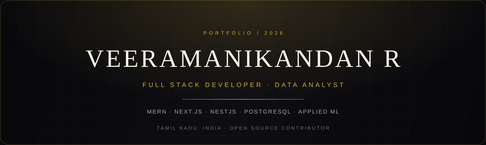
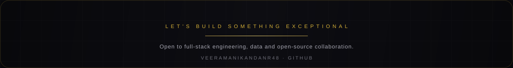

  
    
  <a href="https://veeramanikandan.vercel.app/"><b>Portfolio</b></a>
  &nbsp;&nbsp;·&nbsp;&nbsp;
  <a href="https://www.linkedin.com/in/veeramanikandanr"><b>LinkedIn</b></a>
  &nbsp;&nbsp;·&nbsp;&nbsp;
  <a href="https://github.com/Veeramanikandanr48"><b>GitHub</b></a>
  &nbsp;&nbsp;·&nbsp;&nbsp;
  <a href="mailto:veeramanikandanr48@gmail.com"><b>Email</b></a>

 

  <i>Building thoughtful software at the intersection of product, data and open source.</i>

  

I am a **Full Stack Developer** and **Data Analyst** from Tamil Nadu, India. I design and ship end-to-end products with **React, Next.js, Node.js, NestJS, TypeScript, PostgreSQL and MongoDB** — with a bias for clean architecture, useful tests and interfaces that feel effortless.

<table>
  <tr>
    <td width="50%" valign="top">
      <b>Currently</b>  
      Building invoicing, payroll, attendance and reporting systems. 
      Contributing to open source across Storybook and developer tooling. 
      Exploring AI agents, RAG and applied machine learning.
    </td>
    <td width="50%" valign="top">
      <b>Open to</b>  
      Full-stack engineering roles. 
      Data analyst and analytics engineering work. 
      Open-source collaboration and technical writing.
    </td>
  </tr>
</table>

  

| Discipline | Focus |
| --- | --- |
| **Frontend** | React · Next.js · TypeScript · Tailwind CSS · Storybook |
| **Backend** | Node.js · NestJS · Express · PostgreSQL · MongoDB · Redis |
| **Data** | Python · Pandas · NumPy · scikit-learn · SQL · Power BI |
| **Platform** | Docker · GitHub Actions · AWS · Vercel · Linux · Nginx |

  
  
  
  
  
  
  
  

  

  
  

  

  

  <picture>
    <source media="(prefers-color-scheme: dark)" srcset="https://raw.githubusercontent.com/Veeramanikandanr48/Veeramanikandanr48/output/github-contribution-grid-snake-dark.svg" />
    <source media="(prefers-color-scheme: light)" srcset="https://raw.githubusercontent.com/Veeramanikandanr48/Veeramanikandanr48/output/github-contribution-grid-snake.svg" />
    
  </picture>

  

| Project | Stack | Highlights |
| --- | --- | --- |
| [**CO2 Suite**](https://github.com/Veeramanikandanr48/co2-suite-frontend) | React · NestJS · PostgreSQL | Carbon accounting and ESG workflows with dashboards, reporting and role-aware APIs. |
| [**Claude-of-Duty**](https://github.com/Veeramanikandanr48/Claude-of-Duty) | Three.js · JavaScript | A Call of Duty-style browser FPS experiment built from a single prompt. |
| [**EpiMax Backend**](https://github.com/Veeramanikandanr48/EpiMax-Backend) | Express · SQLite · JWT | REST API for tasks, users and admin operations with authentication and authorisation. |
| [**Project Management Tool**](https://github.com/Veeramanikandanr48/Project_Management_Tool) | MERN Stack | Project and task management with status tracking, user flows and a responsive UI. |
| [**Resume Builder**](https://github.com/Veeramanikandanr48/Resume-Builder) | React · Node.js | A practical resume builder focused on fast editing and clean output. |

  

| Contribution | Repository | Status |
| --- | --- | --- |
| Core: Fix Angular single-story hoisting | [storybookjs/storybook #37533](https://github.com/storybookjs/storybook/pull/37533) | **Open** |
| i18n audit metadata and request ID | [melgarafael/DeskcommCRM #4893](https://github.com/melgarafael/DeskcommCRM/pull/4893) | **Merged** |
| Settings close button alignment | [openslop/openslop #1320](https://github.com/openslop/openslop/pull/1320) | **Merged** |
| CLI `--version` flag | [env-saaf #107](https://github.com/abhi478jeetur-rgb/env-saaf/pull/107) | **Open** |
| `.env` key diff in CLI check | [env-saaf #108](https://github.com/abhi478jeetur-rgb/env-saaf/pull/108) | **Open** |
| New Kumo Sky theme | [kana-dojo #34271](https://github.com/lingdojo/kana-dojo/pull/34271) | **Open** |
| Copy form link action | [easy-quick-form #108](https://github.com/SahinurDEV/easy-quick-form/pull/108) | **Open** |

 

> I contribute where I can leave the codebase better: focused fixes, regression tests, clear docs and reproducible bug reports.

  

  <a href="https://veeramanikandan.vercel.app/">Portfolio</a>
  &nbsp;&nbsp;·&nbsp;&nbsp;
  <a href="https://www.linkedin.com/in/veeramanikandanr">LinkedIn</a>
  &nbsp;&nbsp;·&nbsp;&nbsp;
  <a href="https://twitter.com/veera_r_tech">X</a>
  &nbsp;&nbsp;·&nbsp;&nbsp;
  <a href="https://www.instagram.com/veera_r_/">Instagram</a>
  &nbsp;&nbsp;·&nbsp;&nbsp;
  <a href="https://www.youtube.com/@veeramanikandanR">YouTube</a>
  &nbsp;&nbsp;·&nbsp;&nbsp;
  <a href="mailto:veeramanikandanr48@gmail.com">Email</a>

 

  

