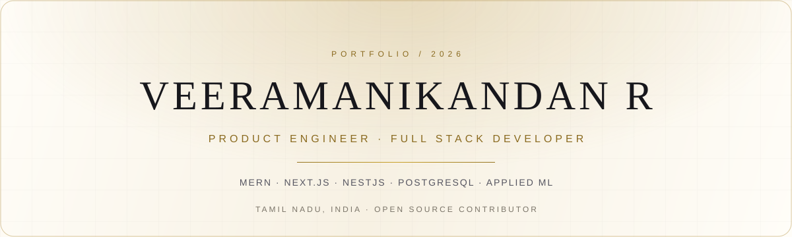
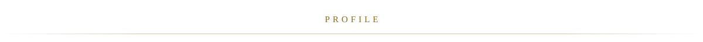
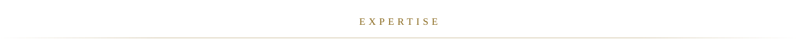
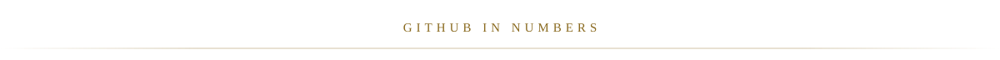
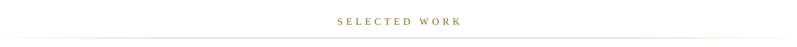
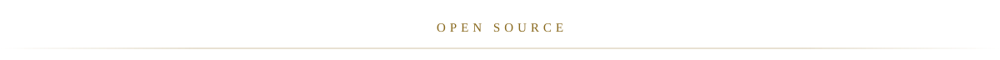
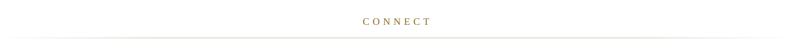
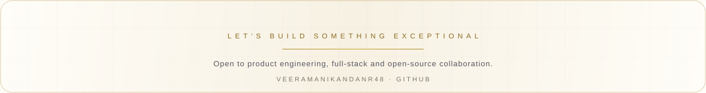

  <picture>
    <source media="(prefers-color-scheme: dark)" srcset="assets/hero.svg" />
    <source media="(prefers-color-scheme: light)" srcset="assets/hero-light.svg" />
    
  </picture>
    
  <a href="https://veeramanikandan.vercel.app/"><b>Portfolio</b></a>
  &nbsp;&nbsp;·&nbsp;&nbsp;
  <a href="https://www.linkedin.com/in/veeramanikandanr"><b>LinkedIn</b></a>
  &nbsp;&nbsp;·&nbsp;&nbsp;
  <a href="https://github.com/Veeramanikandanr48"><b>GitHub</b></a>
  &nbsp;&nbsp;·&nbsp;&nbsp;
  <a href="mailto:veeramanikandanr48@gmail.com"><b>Email</b></a>

 

  <i>Building thoughtful software at the intersection of product, engineering and open source.</i>

<picture>
  <source media="(prefers-color-scheme: dark)" srcset="assets/divider.svg" />
  <source media="(prefers-color-scheme: light)" srcset="assets/divider-light.svg" />
  
</picture>

  <picture>
    <source media="(prefers-color-scheme: dark)" srcset="assets/section-profile.svg" />
    <source media="(prefers-color-scheme: light)" srcset="assets/section-profile-light.svg" />
    
  </picture>

I am a **Product Engineer** and **Full Stack Developer** based in Chennai, India. I turn business problems into scalable digital products with **React, Next.js, Node.js, NestJS, TypeScript, PostgreSQL and MongoDB** — with a bias for clean architecture, useful tests and interfaces that feel effortless.

<table>
  <tr>
    <td width="50%" valign="top">
      <b>Currently</b>  
      Software Development Engineer at VRS CERT, building enterprise sustainability and compliance platforms. 
      Independent consulting on full-stack SaaS products with Next.js, NestJS and PostgreSQL. 
      Previously built FinTech and SaaS products at Finstein. 
      Exploring AI agents, RAG and automation for product workflows.
    </td>
    <td width="50%" valign="top">
      <b>Open to</b>  
      Product engineering roles. 
      Full-stack product work. 
      Open-source collaboration and technical writing.
    </td>
  </tr>
</table>

  <picture>
    <source media="(prefers-color-scheme: dark)" srcset="assets/section-expertise.svg" />
    <source media="(prefers-color-scheme: light)" srcset="assets/section-expertise-light.svg" />
    
  </picture>

| Discipline | Focus |
| --- | --- |
| **Product** | Discovery · Workflow design · API design · Compliance platforms · Automation |
| **Frontend** | React · Next.js · TypeScript · Tailwind CSS · Storybook |
| **Backend** | Node.js · NestJS · Express · PostgreSQL · MongoDB · Redis |
| **Data & ML** | Python · Pandas · NumPy · scikit-learn · SQL · Power BI |
| **Platform** | Docker · GitHub Actions · AWS · Vercel · Linux · Nginx |

  
  
  
  
  
  
  
  

  <picture>
    <source media="(prefers-color-scheme: dark)" srcset="assets/section-github.svg" />
    <source media="(prefers-color-scheme: light)" srcset="assets/section-github-light.svg" />
    
  </picture>

  <picture>
    <source media="(prefers-color-scheme: dark)" srcset="https://github-readme-stats.vercel.app/api?username=Veeramanikandanr48&show_icons=true&count_private=true&rank_icon=github&theme=github_dark&hide_border=true&bg_color=0B0B0F&title_color=D4AF37&icon_color=D4AF37&text_color=E6E6E6&cache_seconds=1800&v=10" />
    <source media="(prefers-color-scheme: light)" srcset="https://github-readme-stats.vercel.app/api?username=Veeramanikandanr48&show_icons=true&count_private=true&rank_icon=github&theme=default&hide_border=true&bg_color=FFFDF8&title_color=8A6A1F&icon_color=8A6A1F&text_color=17171C&cache_seconds=1800&v=10" />
    
  </picture>
  <picture>
    <source media="(prefers-color-scheme: dark)" srcset="https://github-readme-stats.vercel.app/api/top-langs/?username=Veeramanikandanr48&layout=compact&langs_count=8&count_private=true&theme=github_dark&hide_border=true&bg_color=0B0B0F&title_color=D4AF37&text_color=E6E6E6&cache_seconds=1800" />
    <source media="(prefers-color-scheme: light)" srcset="https://github-readme-stats.vercel.app/api/top-langs/?username=Veeramanikandanr48&layout=compact&langs_count=8&count_private=true&theme=default&hide_border=true&bg_color=FFFDF8&title_color=8A6A1F&text_color=17171C&cache_seconds=1800" />
    
  </picture>

  <picture>
    <source media="(prefers-color-scheme: dark)" srcset="https://streak-stats.demolab.com?user=Veeramanikandanr48&theme=github-dark&hide_border=true&background=0B0B0F&ring=D4AF37&fire=D4AF37&currStreakLabel=D4AF37&sideLabels=E6E6E6&dates=8A8F98" />
    <source media="(prefers-color-scheme: light)" srcset="https://streak-stats.demolab.com?user=Veeramanikandanr48&theme=default&hide_border=true&background=FFFDF8&ring=8A6A1F&fire=8A6A1F&currStreakLabel=8A6A1F&sideLabels=17171C&dates=7A7468" />
    
  </picture>

  <picture>
    <source media="(prefers-color-scheme: dark)" srcset="https://github-readme-activity-graph.vercel.app/graph?username=Veeramanikandanr48&bg_color=0B0B0F&color=D4AF37&line=D4AF37&point=F5F5F5&area=true&hide_border=true&custom_title=Contribution%20Activity" />
    <source media="(prefers-color-scheme: light)" srcset="https://github-readme-activity-graph.vercel.app/graph?username=Veeramanikandanr48&bg_color=FFFDF8&color=8A6A1F&line=8A6A1F&point=17171C&area=true&hide_border=true&custom_title=Contribution%20Activity" />
    
  </picture>

  <picture>
    <source media="(prefers-color-scheme: dark)" srcset="https://raw.githubusercontent.com/Veeramanikandanr48/Veeramanikandanr48/output/github-contribution-grid-snake-dark.svg" />
    <source media="(prefers-color-scheme: light)" srcset="https://raw.githubusercontent.com/Veeramanikandanr48/Veeramanikandanr48/output/github-contribution-grid-snake.svg" />
    
  </picture>

  <picture>
    <source media="(prefers-color-scheme: dark)" srcset="assets/section-work.svg" />
    <source media="(prefers-color-scheme: light)" srcset="assets/section-work-light.svg" />
    
  </picture>

| Project | Stack | Highlights |
| --- | --- | --- |
| [**CO2 Suite**](https://github.com/Veeramanikandanr48/co2-suite-frontend) | React · NestJS · PostgreSQL | Carbon accounting and ESG workflows with dashboards, reporting and role-aware APIs. |
| [**Claude-of-Duty**](https://github.com/Veeramanikandanr48/Claude-of-Duty) | Three.js · JavaScript | A Call of Duty-style browser FPS experiment built from a single prompt. |
| [**EpiMax Backend**](https://github.com/Veeramanikandanr48/EpiMax-Backend) | Express · SQLite · JWT | REST API for tasks, users and admin operations with authentication and authorisation. |
| [**Project Management Tool**](https://github.com/Veeramanikandanr48/Project_Management_Tool) | MERN Stack | Project and task management with status tracking, user flows and a responsive UI. |
| [**Resume Builder**](https://github.com/Veeramanikandanr48/Resume-Builder) | React · Node.js | A practical resume builder focused on fast editing and clean output. |

  <picture>
    <source media="(prefers-color-scheme: dark)" srcset="assets/section-open-source.svg" />
    <source media="(prefers-color-scheme: light)" srcset="assets/section-open-source-light.svg" />
    
  </picture>

| Contribution | Repository | Status |
| --- | --- | --- |
| Core: Fix Angular single-story hoisting | [storybookjs/storybook #37533](https://github.com/storybookjs/storybook/pull/37533) | **Open** |
| i18n audit metadata and request ID | [melgarafael/DeskcommCRM #4893](https://github.com/melgarafael/DeskcommCRM/pull/4893) | **Merged** |
| Settings close button alignment | [openslop/openslop #1320](https://github.com/openslop/openslop/pull/1320) | **Merged** |
| CLI `--version` flag | [env-saaf #107](https://github.com/abhi478jeetur-rgb/env-saaf/pull/107) | **Open** |
| `.env` key diff in CLI check | [env-saaf #108](https://github.com/abhi478jeetur-rgb/env-saaf/pull/108) | **Open** |
| New Kumo Sky theme | [kana-dojo #34271](https://github.com/lingdojo/kana-dojo/pull/34271) | **Open** |
| Copy form link action | [easy-quick-form #108](https://github.com/SahinurDEV/easy-quick-form/pull/108) | **Open** |

 

> I contribute where I can leave the codebase better: focused fixes, regression tests, clear docs and reproducible bug reports.

  <picture>
    <source media="(prefers-color-scheme: dark)" srcset="assets/section-connect.svg" />
    <source media="(prefers-color-scheme: light)" srcset="assets/section-connect-light.svg" />
    
  </picture>

  <a href="https://veeramanikandan.vercel.app/">Portfolio</a>
  &nbsp;&nbsp;·&nbsp;&nbsp;
  <a href="https://www.linkedin.com/in/veeramanikandanr">LinkedIn</a>
  &nbsp;&nbsp;·&nbsp;&nbsp;
  <a href="https://twitter.com/veera_r_tech">X</a>
  &nbsp;&nbsp;·&nbsp;&nbsp;
  <a href="https://www.instagram.com/veera_r_/">Instagram</a>
  &nbsp;&nbsp;·&nbsp;&nbsp;
  <a href="https://www.youtube.com/@veeramanikandanR">YouTube</a>
  &nbsp;&nbsp;·&nbsp;&nbsp;
  <a href="mailto:veeramanikandanr48@gmail.com">Email</a>

 

  <picture>
    <source media="(prefers-color-scheme: dark)" srcset="assets/footer.svg" />
    <source media="(prefers-color-scheme: light)" srcset="assets/footer-light.svg" />
    
  </picture>

